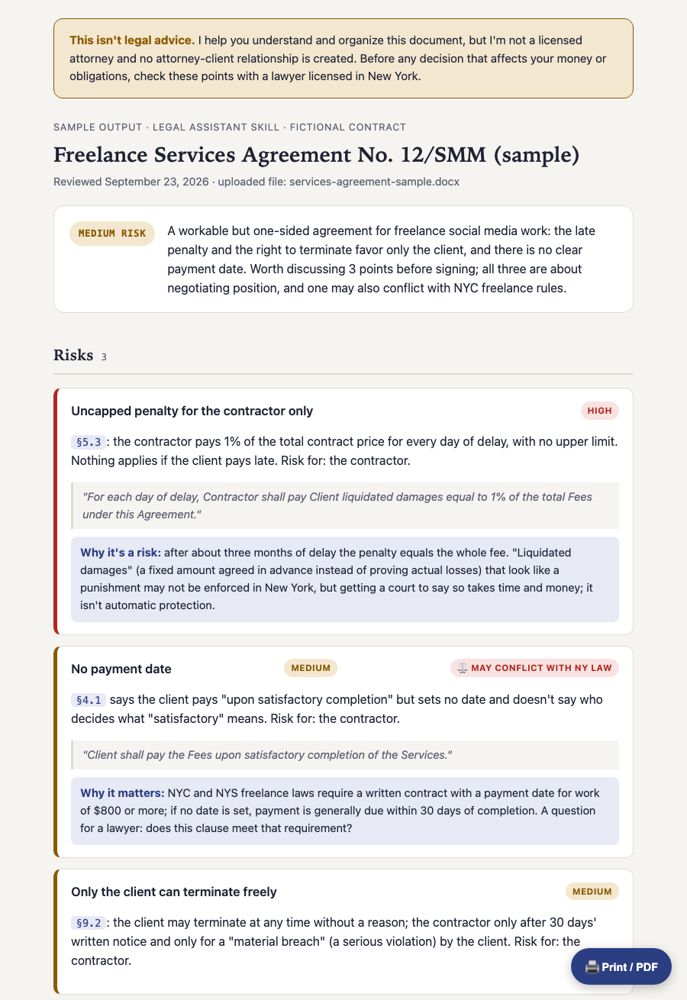

# Claude Skills

Custom skills and automations for Claude Code that I built and use in my own work. This page describes what each one does and shows sample output. The source is private.

| Skill | What it does |
|---|---|
| **Legal Assistant** | Reads a contract with New York State and New York City rules in mind. Flags risky clauses, checks section and exhibit references, suggests better wording and produces a plain-English HTML report with color-coded risk levels. Handles one document or a batch in a single report. |
| **AI Text Critic** | Checks whether an English text reads as AI-written and rewrites it in plain American business English. Built for resumes, cover letters and LinkedIn posts. Includes a Python script that scores the text. |
| **Telegram Notifier** | Sets up a personal Telegram bot so scripts, scheduled tasks and Claude itself can send short status messages to my phone. No server, one API call. |
| **Scheduled automations** | Tasks Claude runs on its own on a schedule: a weekday morning brief and a daily capture of public data from a website. |

## Sample output

### Legal Assistant

A review of a fictional freelance services agreement. Three risks, one broken exhibit reference, three proposed rewrites and a numbering check.

[Open the full report](https://mariamatveeva2020.github.io/claude-skills/examples/contract-review-sample.html)

### AI Text Critic

A fictional resume summary and cover-letter opening, before and after. The AI trace score drops from 68/100 to 6/100.

[See the before and after](examples/text-check-before-after.md)

### Telegram Notifier

How the bot is set up and what its messages look like.

[See how it works](examples/telegram-notifier.md)

### Scheduled automations

What runs, when, and what lands on my phone.

[See the automations](examples/scheduled-automations.md)

## Note on the legal skill

The Legal Assistant prepares facts for a conversation with a lawyer. It does not give legal advice, does not say whether to sign, and does not replace a licensed attorney.

## Want to see one in action?

I'm happy to walk through a skill live. Reach out on LinkedIn.
